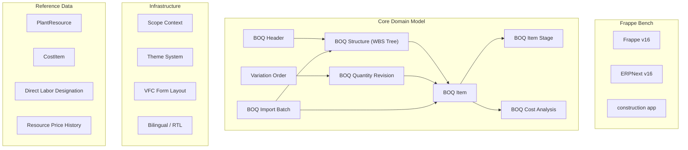
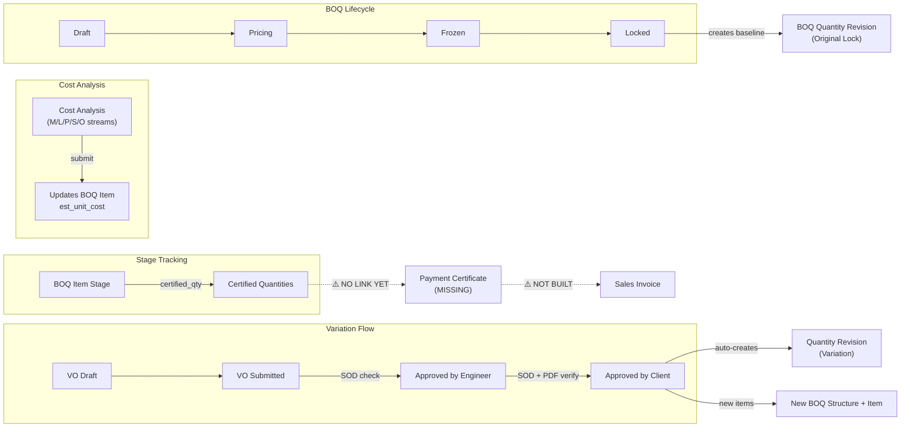
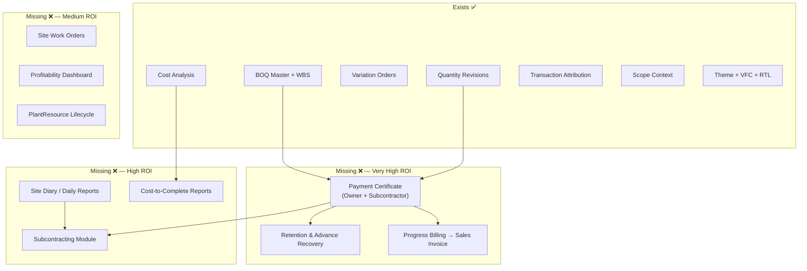
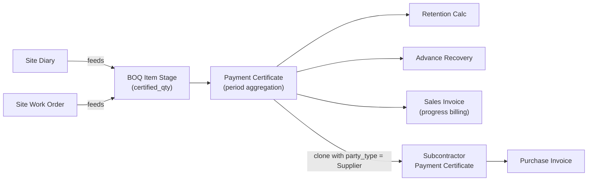
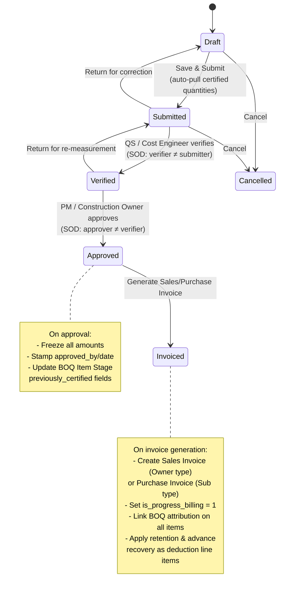
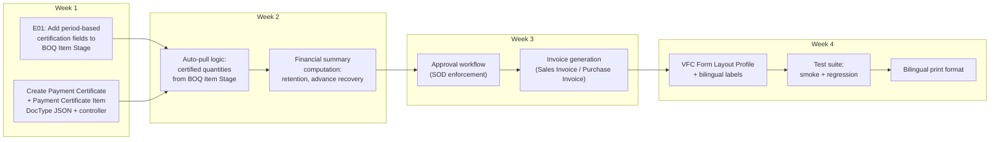

# Construction ERP Platform — End-to-End Analysis Report

> **Version:** 1.0 · **Date:** 2026-10-08 · **Release Tag:** `v6.8.0-rc1`
> **Platform:** Frappe v16 + ERPNext v16 + `construction` app

---

## Table of Contents

1. [Executive Summary](#1-executive-summary)
2. [Current Platform State](#2-current-platform-state)
3. [Gap Analysis — Existing Module Enhancements](#3-gap-analysis--existing-module-enhancements)
4. [Gap Analysis — Missing Transaction Modules](#4-gap-analysis--missing-transaction-modules)
5. [Strategic Recommendation: Payment Certificate First](#5-strategic-recommendation-payment-certificate-first)
6. [Payment Certificate v1 — Detailed Specification](#6-payment-certificate-v1--detailed-specification)
7. [Enhancement Backlog for Existing Modules](#7-enhancement-backlog-for-existing-modules)
8. [Implementation Roadmap](#8-implementation-roadmap)
9. [Risk Assessment & Mitigations](#9-risk-assessment--mitigations)
10. [Appendices](#10-appendices)

---

## 1. Executive Summary

The `construction` app has reached a **stable, production-ready foundation** with 21 DocTypes, 16 passed release gates, a CI pipeline covering 24 test modules, and enterprise-grade infrastructure (scope context, bilingual/RTL, theme system, VFC form layouts). The BOQ domain model — Header → Structure (WBS) → Item → Item Stage → Cost Analysis — is mature, with Variation Orders and Quantity Revisions fully implemented including FIDIC 25% rule enforcement.

However, the platform stops short of the **commercial transaction layer** that Egypt/Gulf contractors need most: there is no Payment Certificate (مستخلص), no Subcontracting module, no Site Diary, and no committed/actual/cost-to-complete rollups. These are the features that competing ERPs (NTS, FALCON, CivitBUILD, FACTS, Horizon/FIT, AccFlex, Arkan) use as their primary sales differentiators.

> [!IMPORTANT]
> **Primary recommendation:** Build **Payment Certificates (مستخلصات)** as the next module. The foundation already exists (`BOQ Item Stage` certified quantities, VO/revision history, BOQ attribution on invoices), and this single module unlocks progress billing, retention, advance recovery, and the subcontractor payment flow — the highest-ROI market gap.

---

## 2. Current Platform State

### 2.1 Architecture Overview



### 2.2 DocType Inventory (21 DocTypes)

| Category | DocType | Status | Submittable |
|---|---|---|---|
| **BOQ Core** | `BOQ Header` | ✅ Production | No (state machine) |
| | `BOQ Structure` | ✅ Production | No (NestedSet) |
| | `BOQ Item` | ✅ Production | No |
| | `BOQ Item Stage` | ✅ Production | No |
| | `BOQ Cost Analysis` | ✅ Production | **Yes** |
| | `BOQ Cost Analysis Detail` | ✅ Production | Child table |
| **Variations** | `Variation Order` | ✅ Production | No (workflow) |
| | `VO Line` | ✅ Production | Child table |
| | `BOQ Quantity Revision` | ✅ Production | No (approval) |
| **Import** | `BOQ Import Batch` | ✅ Production | No |
| **Reference Data** | `PlantResource` | ⚠️ Schema only (not migrated) | No |
| | `CostItem` | ⚠️ Schema only (not migrated) | No |
| | `Direct Labor Designation` | ✅ Production | Child table |
| | `Resource Price History` | ✅ Production | No |
| **Infrastructure** | `Construction Settings` | ✅ Production | Single |
| | `Construction Theme` | ✅ Production | No |
| | `Modern Theme Settings` | ✅ Production | Single |
| | `User Desk Theme` | ✅ Production | No |
| | `Form Layout Profile` | ✅ Production | No |
| | `User Scope Context` | ✅ Production | No |
| | `Scope Report Access Log` | ✅ Production | No |

### 2.3 BOQ Data Flow — Current Capabilities



### 2.4 Infrastructure Maturity

| Capability | Implementation | Maturity |
|---|---|---|
| **Scope Context** | SQL query injection (`permission_query_conditions["*"]`), document save enforcement, navbar dropdowns, list/form auto-filtering | 🟢 Enterprise-grade |
| **Bilingual / RTL** | 2,500+ line localization gate script, Egyptian accountant-reviewed translations, Arabic normalized search fields, bilingual print formats | 🟢 Production |
| **Theme System** | 1,180+ scoped CSS selectors, Light/Dark/Custom themes, per-user preferences, WCAG AA contrast checks, Arabic typography (Cairo, Tajawal, Almarai, Noto Sans Arabic) | 🟢 Production |
| **VFC Form Layout** | JSON-driven section cards, role/user targeting, priority cascade, DOM re-parenting engine | 🟢 Production |
| **CI / Quality** | 24 test modules (7 smoke + 17 regression), 4 linters, schema drift checker, GitHub Actions on Ubuntu 24.04 / Python 3.14 / Node 24 / MariaDB 10.11 | 🟢 Production |

### 2.5 BOQ Transaction Attribution (Existing Cross-Module Links)

The construction app hooks into 7 standard ERPNext transaction DocTypes with BOQ attribution fields:

| ERPNext DocType | Attribution Fields | Status |
|---|---|---|
| Purchase Order | `boq_header`, `boq_structure`, `boq_item` | ✅ Enforced |
| Purchase Receipt | `boq_header`, `boq_structure`, `boq_item` | ✅ Enforced |
| Purchase Invoice | `boq_header`, `boq_structure`, `boq_item` | ✅ Enforced |
| Sales Invoice | `boq_header`, `boq_structure`, `boq_item`, `is_progress_billing` | ✅ Enforced |
| Stock Entry | `boq_header`, `boq_structure`, `boq_item` | ✅ Enforced |
| Timesheet | `boq_header`, `boq_structure`, `boq_item` | ✅ Enforced (mandatory for Direct Labor) |
| Material Request | `boq_header`, `boq_structure`, `boq_item` | ✅ Enforced |

> [!NOTE]
> **Key finding:** `Sales Invoice Item` already has a custom `is_progress_billing` (Check) field, and the Egyptian COA fixture includes Account `1220` ("مستخلصات عقود مستحقة" — Contract Certificates Receivable). The accounting foundation for Payment Certificates is partially pre-wired.

---

## 3. Gap Analysis — Existing Module Enhancements

### 3.1 BOQ Item Stage: Passive Tracking → Active Measurement Workflow

**Current state:** `BOQ Item Stage` tracks `measured_executed_qty`, `certified_qty`, and `percent_complete` with role-gated certification (PM / Construction Owner / System Manager). Once certified, fields become immutable.

**What's missing:**

| Gap | Description | Impact |
|---|---|---|
| **Measurement sheet workflow** | No formal multi-step approval: Surveyor measures → Engineer verifies → PM certifies. Currently a single status flip. | Medium-High — Contractors need audit trail for disputed measurements |
| **Attachment support** | No mechanism to attach measurement sketches, photos, or survey data to a stage | Medium — Required for FIDIC compliance documentation |
| **Measurement history** | No versioned log of measurement changes before certification | Medium — Auditors need change trail |
| **Partial certification** | `certified_qty` is all-or-nothing per stage. No concept of "certified this period" vs "cumulative certified" | **High** — Payment certificates need period-based deltas |

**Recommended enhancements:**

```
BOQ Item Stage (enhanced)
├── measurement_date          (Date)
├── measured_by              (Link: User)
├── measurement_attachments  (Table: Measurement Attachment)  ← new child table
├── previously_certified_qty (Float, read-only)
├── current_period_qty       (Float)  ← certified_qty - previously_certified_qty
├── measurement_status       (Select: Pending → Verified → Certified → Disputed)
└── measurement_remarks      (Small Text)
```

### 3.2 Cost Rollups: Attribution Without Aggregation

**Current state:** Every Purchase Order, Purchase Invoice, Stock Entry, Timesheet, and Journal Entry carries `boq_header`/`boq_structure`/`boq_item` attribution. BOQ Cost Analysis provides estimated unit costs. But these two data sets are **never joined** into a cost report.

**What's missing:**

| Metric | Source Data Available | Rollup Exists |
|---|---|---|
| **Committed cost** | PO amounts with BOQ attribution | ❌ No |
| **Actual cost** | PI + Stock Entry + Timesheet + JE amounts | ❌ No |
| **Budgeted cost** | `BOQ Item.est_line_total` via Cost Analysis | ✅ Yes (item level) |
| **Earned value** | `certified_qty × contract_unit_price` | ❌ No (computable but not stored) |
| **Cost to complete** | `(total_qty - executed_qty) × est_unit_cost` | ❌ No |
| **Estimate at completion** | `actual + cost_to_complete` | ❌ No |
| **Variance** | `budgeted - EAC` | ❌ No |

**Recommended enhancement:** A `BOQ Cost Rollup` service (not a DocType — a computed view or report) that queries transaction amounts by BOQ attribution and produces EVM (Earned Value Management) metrics at the Item, Structure, and Header levels.

### 3.3 PlantResource: Schema Without Lifecycle

**Current state:** `PlantResource` has 5 fields (`resource_code`, `equipment_type`, `ownership_cost_hourly`, `operating_cost_hourly`, `mobilization_cost`). It was removed from the migration seeder in commit `b640569` and is not instantiated in the database.

**What's missing:**

| Gap | Description |
|---|---|
| **Mobilization tracking** | No workflow: `Available → Mobilized → On Site → Demobilized` |
| **Utilization logging** | No daily/weekly utilization records linked to project/BOQ |
| **Allocation** | No mechanism to allocate a plant resource to a project for a period |
| **Rate escalation** | No fuel/maintenance cost adjustment over time |
| **Integration with Cost Analysis** | `cost_stream = "P"` in Cost Analysis Detail links to generic `Item`, not `PlantResource` |

**Recommended approach:** Defer `PlantResource` maturation until after Payment Certificates and Subcontracting. The `BOQ Cost Analysis Detail` with `cost_stream = "P"` adequately covers rate estimation for now.

### 3.4 Retention & Advance Recovery: Completely Absent

**Current state:** No retention or advance recovery mechanism exists anywhere in the codebase. The Egyptian COA fixture includes retention-related accounts, but no DocType or logic references them.

**What's missing:**

| Mechanism | Description | Standard Practice |
|---|---|---|
| **Retention deduction** | Withhold 5-10% of each certificate until practical completion | FIDIC 14.3, Egyptian Civil Code |
| **Retention release** | Release 50% at practical completion, 50% at end of defects liability | FIDIC 14.9 |
| **Advance payment** | Lump-sum mobilization advance (10-20% of contract value) | FIDIC 14.2 |
| **Advance recovery** | Deduct proportional advance repayment from each certificate | FIDIC 14.2 |
| **Performance bond tracking** | Monitor guarantee validity and amounts | Market requirement |

> [!WARNING]
> This is the single most-requested feature by Egyptian and Gulf contractors. Every competitor ERP handles retention and advance recovery as core functionality. Building this into the Payment Certificate module is critical.

---

## 4. Gap Analysis — Missing Transaction Modules

### 4.1 Market Gap Matrix

Based on the [feature review](file:///home/mohamed/frappe-bench/apps/construction/docs/feature_reviews/07_egypt_gulf_enterprise_roi_review.md) and codebase analysis:



### 4.2 Competitor Feature Comparison

| Feature | NTS | FALCON | CivitBUILD | AccFlex | **This App** |
|---|---|---|---|---|---|
| BOQ + WBS hierarchy | ✅ | ✅ | ✅ | ✅ | ✅ |
| Cost analysis / rate build-up | ✅ | ✅ | ✅ | ⚠️ | ✅ |
| Variation orders | ✅ | ✅ | ✅ | ⚠️ | ✅ |
| **Payment certificates (IPC)** | ✅ | ✅ | ✅ | ✅ | ❌ |
| **Retention management** | ✅ | ✅ | ✅ | ✅ | ❌ |
| **Advance recovery** | ✅ | ✅ | ✅ | ✅ | ❌ |
| **Subcontractor management** | ✅ | ✅ | ✅ | ⚠️ | ❌ |
| **Site diary** | ✅ | ✅ | ⚠️ | ❌ | ❌ |
| Progress billing | ✅ | ✅ | ✅ | ✅ | ⚠️ (attribution only) |
| Scope / multi-project | ⚠️ | ✅ | ⚠️ | ⚠️ | ✅ |
| Bilingual Arabic / RTL | ⚠️ | ✅ | ⚠️ | ✅ | ✅ |
| Theme / UX customization | ❌ | ⚠️ | ❌ | ❌ | ✅ |

---

## 5. Strategic Recommendation: Payment Certificate First

### 5.1 Why Payment Certificate Before Subcontracting or Site Diary



**Rationale for sequencing:**

1. **Foundation already exists:** `BOQ Item Stage` has `certified_qty` with role-gated certification. The certificate naturally aggregates these into a period document.

2. **Immediate revenue impact:** Progress billing is the #1 financial workflow for contractors. Without it, the ERP cannot close the BOQ → Invoice loop.

3. **Reusability:** The subcontractor certificate is a near-clone of the owner certificate with `party_type = Supplier` instead of `Customer`. One DocType, one approval engine, two use cases.

4. **Dependency direction:** Site Diary and Subcontracting both depend on the same measurement/certification layer that the Payment Certificate formalizes. Building the certificate first establishes the approval patterns that downstream modules reuse.

5. **Market positioning:** Per the ROI review, "Payment Certificate / IPC" is rated **Missing, Very High ROI** for both owner and subcontractor variants. This is the single biggest competitive gap.

### 5.2 Build vs. Extend Decision

| Option | Approach | Verdict |
|---|---|---|
| Extend `Sales Invoice` | Add certificate fields to SI | ❌ Rejected — SI is a financial document; certificate is a technical/contractual document with different approval flows |
| Use ERPNext `Payment Entry` | Map certificate to payment entry | ❌ Rejected — Payment Entry is treasury settlement, not progress certification |
| **New DocType `Payment Certificate`** | Purpose-built construction certificate that **generates** a Sales Invoice on approval | ✅ **Recommended** — Clean separation of concerns, matches FIDIC/Egyptian practice |

---

## 6. Payment Certificate v1 — Detailed Specification

### 6.1 DocType: `Payment Certificate` (مستخلص)

**Naming:** `IPC-.project.-.####` (e.g., `IPC-PROJ-001-0001`)
**Is Submittable:** Yes
**Module:** `construction`

#### Header Fields

| Field | Type | Options / Details | Required | Arabic Label |
|---|---|---|---|---|
| `certificate_type` | Select | `Owner` (مستخلص مالك), `Subcontractor` (مستخلص مقاول باطن) | ✅ | نوع المستخلص |
| `project` | Link | → `Project` | ✅ | المشروع |
| `boq_header` | Link | → `BOQ Header` (must be `Locked`) | ✅ | جدول الكميات |
| `party_type` | Select | `Customer`, `Supplier` | ✅ (auto from `certificate_type`) | نوع الطرف |
| `party` | Dynamic Link | → `party_type` | ✅ | الطرف |
| `certificate_no` | Int | Sequential per project | ✅ | رقم المستخلص |
| `period_from` | Date | Start of measurement period | ✅ | من تاريخ |
| `period_to` | Date | End of measurement period | ✅ | إلى تاريخ |
| `certificate_date` | Date | Date of certificate issue | ✅ | تاريخ المستخلص |
| `status` | Select | `Draft` → `Submitted` → `Verified` → `Approved` → `Invoiced` → `Cancelled` | ✅ | الحالة |
| `contract_value` | Currency | Pulled from BOQ Header `total_revised_value` | Read-only | قيمة العقد |
| `previous_certificate` | Link | → `Payment Certificate` (last approved for same project+party) | Auto | المستخلص السابق |

#### Line Items — Child Table: `Payment Certificate Item` (بند المستخلص)

| Field | Type | Options / Details | Arabic Label |
|---|---|---|---|
| `boq_item` | Link | → `BOQ Item` | بند جدول الكميات |
| `boq_structure` | Link | → `BOQ Structure` (auto-fetch) | هيكل جدول الكميات |
| `description` | Data | Fetched from BOQ Structure title | الوصف |
| `description_ar` | Data | Fetched from BOQ Structure title_ar | الوصف بالعربية |
| `unit` | Link | → `UOM` | الوحدة |
| `contract_qty` | Float | BOQ Item `current_revised_qty` or `quantity` | الكمية التعاقدية |
| `contract_unit_price` | Currency | BOQ Item `contract_unit_price` | سعر الوحدة التعاقدي |
| `previous_qty` | Float | Sum of certified qty from all prior certificates | الكمية السابقة |
| `previous_amount` | Currency | Computed | المبلغ السابق |
| `current_qty` | Float | This period's certified quantity (auto-pulled from BOQ Item Stage, editable) | كمية الفترة الحالية |
| `cumulative_qty` | Float | `previous_qty + current_qty` | الكمية التراكمية |
| `cumulative_amount` | Currency | `cumulative_qty × contract_unit_price` | المبلغ التراكمي |
| `current_amount` | Currency | `cumulative_amount - previous_amount` | مبلغ الفترة الحالية |
| `percent_complete` | Percent | `cumulative_qty / contract_qty × 100` | نسبة الإنجاز |
| `boq_item_stage` | Link | → `BOQ Item Stage` (source of certified_qty) | مرحلة البند |

#### Financial Summary Section (ملخص مالي)

| Field | Type | Computation | Arabic Label |
|---|---|---|---|
| `gross_amount_cumulative` | Currency | Sum of all line `cumulative_amount` | إجمالي الأعمال التراكمي |
| `gross_amount_current` | Currency | Sum of all line `current_amount` | إجمالي أعمال الفترة |
| `gross_amount_previous` | Currency | Sum of all line `previous_amount` | إجمالي الأعمال السابقة |
| **Deductions Section** | | | **الخصومات** |
| `retention_pct` | Percent | Default from Construction Settings | نسبة محتجزات الضمان |
| `retention_amount` | Currency | `gross_amount_cumulative × retention_pct` | محتجزات الضمان |
| `previous_retention` | Currency | From previous certificate | محتجزات سابقة |
| `current_retention` | Currency | `retention_amount - previous_retention` | محتجزات الفترة |
| `advance_payment_total` | Currency | Total advance paid | إجمالي السلفة المقدمة |
| `advance_recovery_pct` | Percent | Recovery rate per certificate | نسبة استرداد السلفة |
| `advance_recovered_previous` | Currency | From previous certificate | سلفة مستردة سابقاً |
| `advance_recovered_current` | Currency | `gross_amount_current × advance_recovery_pct` | استرداد سلفة الفترة |
| `advance_recovered_cumulative` | Currency | Capped at `advance_payment_total` | إجمالي السلفة المستردة |
| `other_deductions` | Currency | Penalties, back-charges, etc. | خصومات أخرى |
| `other_deductions_description` | Small Text | | وصف الخصومات الأخرى |
| **Taxes** | | | **الضرائب** |
| `tax_pct` | Percent | VAT / GST rate | نسبة الضريبة |
| `tax_amount` | Currency | `(gross_amount_current - current_retention - advance_recovered_current) × tax_pct` | مبلغ الضريبة |
| **Net** | | | **الصافي** |
| `net_amount_current` | Currency | `gross_amount_current - current_retention - advance_recovered_current - other_deductions + tax_amount` | صافي المستحق للفترة |
| `net_amount_cumulative` | Currency | Running total | صافي المستحق التراكمي |

#### Approval & Invoice Fields

| Field | Type | Arabic Label |
|---|---|---|
| `verified_by` | Link → `User` | تم التدقيق بواسطة |
| `verified_date` | Datetime | تاريخ التدقيق |
| `approved_by` | Link → `User` | تم الاعتماد بواسطة |
| `approved_date` | Datetime | تاريخ الاعتماد |
| `sales_invoice` | Link → `Sales Invoice` | فاتورة المبيعات |
| `purchase_invoice` | Link → `Purchase Invoice` | فاتورة المشتريات |
| `remarks` | Text | ملاحظات |

### 6.2 Workflow State Machine



### 6.3 Auto-Pull Logic (Certified Quantities)

When a `Payment Certificate` is created or refreshed:

```python
# Pseudocode for line population
def pull_certified_quantities(self):
    """Pull current certified quantities from BOQ Item Stages."""
    stages = frappe.get_all("BOQ Item Stage",
        filters={
            "boq_header": self.boq_header,
            "stage_status": "Certified"
        },
        fields=["boq_item", "boq_structure", "certified_qty", "name"]
    )

    # Group by BOQ Item (multiple stages per item)
    item_totals = {}
    for stage in stages:
        key = stage.boq_item
        if key not in item_totals:
            item_totals[key] = {
                "total_certified": 0,
                "stages": [],
                "boq_structure": stage.boq_structure
            }
        item_totals[key]["total_certified"] += stage.certified_qty
        item_totals[key]["stages"].append(stage.name)

    # Calculate previous from last approved certificate
    previous = get_previous_certificate_lines(self.project, self.party)

    for boq_item_name, data in item_totals.items():
        boq_item = frappe.get_doc("BOQ Item", boq_item_name)
        prev_qty = previous.get(boq_item_name, {}).get("cumulative_qty", 0)
        current_qty = data["total_certified"] - prev_qty

        if current_qty != 0:  # Include items with work this period
            self.append("items", {
                "boq_item": boq_item_name,
                "boq_structure": data["boq_structure"],
                "unit": boq_item.unit,
                "contract_qty": boq_item.current_revised_qty or boq_item.quantity,
                "contract_unit_price": boq_item.contract_unit_price,
                "previous_qty": prev_qty,
                "current_qty": current_qty,
                "cumulative_qty": prev_qty + current_qty,
            })
```

### 6.4 Invoice Generation Logic

```python
# On transition to "Invoiced"
def generate_invoice(self):
    if self.certificate_type == "Owner":
        invoice = frappe.new_doc("Sales Invoice")
        invoice.customer = self.party
        invoice_item_doctype = "Sales Invoice Item"
    else:
        invoice = frappe.new_doc("Purchase Invoice")
        invoice.supplier = self.party
        invoice_item_doctype = "Purchase Invoice Item"

    invoice.project = self.project
    invoice.payment_certificate = self.name  # custom link field

    # Add work items
    for line in self.items:
        invoice.append("items", {
            "item_code": get_service_item(),  # generic "Construction Work" item
            "qty": line.current_qty,
            "rate": line.contract_unit_price,
            "amount": line.current_amount,
            "boq_header": self.boq_header,
            "boq_structure": line.boq_structure,
            "boq_item": line.boq_item,
            "is_progress_billing": 1,
            "description": f"IPC #{self.certificate_no}: {line.description}"
        })

    # Add retention deduction (negative line or use Payment Schedule)
    if self.current_retention:
        invoice.append("items", {
            "item_code": get_retention_item(),
            "qty": 1,
            "rate": -self.current_retention,
            "description": f"Retention @ {self.retention_pct}%"
        })

    # Add advance recovery deduction
    if self.advance_recovered_current:
        invoice.append("items", {
            "item_code": get_advance_recovery_item(),
            "qty": 1,
            "rate": -self.advance_recovered_current,
            "description": f"Advance Recovery @ {self.advance_recovery_pct}%"
        })

    invoice.insert()
    invoice.submit()

    self.db_set("sales_invoice" if self.certificate_type == "Owner"
                else "purchase_invoice", invoice.name)
    self.db_set("status", "Invoiced")
```

### 6.5 Validation Rules

| Rule | Description | Error Message (EN) | Error Message (AR) |
|---|---|---|---|
| V01 | BOQ Header must be `Locked` | "BOQ Header must be in Locked status to create a Payment Certificate" | "يجب أن يكون جدول الكميات في حالة مقفل لإنشاء مستخلص" |
| V02 | `period_to >= period_from` | "Period end date must be after start date" | "تاريخ نهاية الفترة يجب أن يكون بعد تاريخ البداية" |
| V03 | No overlapping periods for same project+party | "Certificate period overlaps with {existing}" | "فترة المستخلص تتداخل مع {existing}" |
| V04 | `cumulative_qty <= contract_qty` for each line | "Cumulative quantity {cum} exceeds contract quantity {con} for item {item}" | "الكمية التراكمية {cum} تتجاوز الكمية التعاقدية {con} للبند {item}" |
| V05 | `current_qty >= 0` (no negative progress without VO) | "Current period quantity cannot be negative" | "كمية الفترة الحالية لا يمكن أن تكون سالبة" |
| V06 | `advance_recovered_cumulative <= advance_payment_total` | "Total advance recovery cannot exceed advance payment" | "إجمالي استرداد السلفة لا يمكن أن يتجاوز مبلغ السلفة" |
| V07 | SOD: Verifier ≠ Submitter | "Verifier cannot be the same user who submitted the certificate" | "المدقق لا يمكن أن يكون نفس المستخدم الذي قدم المستخلص" |
| V08 | SOD: Approver ≠ Verifier | "Approver cannot be the same user who verified the certificate" | "المعتمد لا يمكن أن يكون نفس المستخدم الذي دقق المستخلص" |

### 6.6 Permissions

| Role | Read | Write | Submit | Amend | Cancel |
|---|---|---|---|---|---|
| Accounts User | ✅ | ❌ | ❌ | ❌ | ❌ |
| Projects User | ✅ | ✅ | ❌ | ❌ | ❌ |
| Projects Manager | ✅ | ✅ | ✅ | ✅ | ❌ |
| Construction Owner | ✅ | ✅ | ✅ | ✅ | ✅ |
| System Manager | ✅ | ✅ | ✅ | ✅ | ✅ |

### 6.7 New DocTypes Required

| DocType | Type | Purpose |
|---|---|---|
| `Payment Certificate` | Main, Submittable | The certificate document (مستخلص) |
| `Payment Certificate Item` | Child Table | Line items with quantities and amounts |
| `Measurement Attachment` | Child Table | Attachments for measurement evidence on BOQ Item Stage |

### 6.8 Custom Fields on Existing DocTypes

| Target DocType | Field | Type | Purpose |
|---|---|---|---|
| `Sales Invoice` | `payment_certificate` | Link → `Payment Certificate` | Back-link to source certificate |
| `Purchase Invoice` | `payment_certificate` | Link → `Payment Certificate` | Back-link to source certificate |
| `Construction Settings` | `default_retention_pct` | Percent | Global retention default |
| `Construction Settings` | `default_advance_recovery_pct` | Percent | Global advance recovery default |
| `Construction Settings` | `service_item_for_billing` | Link → `Item` | Generic service item for invoice generation |
| `Construction Settings` | `retention_item` | Link → `Item` | Item code for retention deduction lines |
| `Construction Settings` | `advance_recovery_item` | Link → `Item` | Item code for advance recovery lines |

### 6.9 VFC Form Layout Profile

A default `Form Layout Profile` should be seeded for `Payment Certificate` with:

- **Section 1:** Certificate Identity (type, project, BOQ, party, period)
- **Section 2:** Line Items (full-width table)
- **Section 3:** Financial Summary (2-column: gross amounts | deductions)
- **Section 4:** Approval Trail (verified/approved by/date)
- **Section 5:** Invoice Link & Remarks

---

## 7. Enhancement Backlog for Existing Modules

### Priority Matrix

| # | Enhancement | Module | Effort | Impact | Dependency |
|---|---|---|---|---|---|
| E01 | **Period-based certification on BOQ Item Stage** (previously_certified_qty, current_period_qty) | BOQ Item Stage | S | High | Prerequisite for Payment Certificate |
| E02 | **Measurement attachment child table** | BOQ Item Stage | S | Medium | Nice-to-have for v1 |
| E03 | **Committed cost rollup** (PO amounts by BOQ attribution) | Report / Service | M | High | Independent |
| E04 | **Actual cost rollup** (PI + SE + TS + JE by BOQ attribution) | Report / Service | M | High | Independent |
| E05 | **Earned value calculation** (certified_qty × contract_unit_price) | Report / Service | S | High | After Payment Certificate |
| E06 | **Cost-to-complete projection** | Report / Service | M | High | After E03, E04 |
| E07 | **PlantResource migration + basic lifecycle** | PlantResource | L | Medium | Independent, defer |
| E08 | **CostItem migration + BOQ Item link** | CostItem | M | Medium | Independent, defer |
| E09 | **Retention release workflow** (at practical completion + defects liability end) | Payment Certificate | M | High | After Payment Certificate v1 |
| E10 | **Certificate print format** (bilingual, matches Egyptian standard form) | Print Format | M | High | After Payment Certificate v1 |
| E11 | **MCP tool fix: `get_boq_header`** items iteration bug (line 182 of server.py) | MCP Server | S | Low | Independent |

> [!TIP]
> **E11 — MCP Bug:** In [`server.py`](file:///home/mohamed/frappe-bench/apps/construction/erpnext-mcp-server/server.py), the `get_boq_header` tool iterates over `doc.get("items", [])`. Since `BOQ Item` is a separate DocType (not a child table), this returns `None` and raises `'NoneType' object is not iterable`. Fix: query `BOQ Item` separately with `filters={"boq_header": name}`.

**Effort key:** S = Small (1-3 days), M = Medium (1-2 weeks), L = Large (2-4 weeks)

---

## 8. Implementation Roadmap

### Phase 1: Payment Certificate v1 (Weeks 1–4)



### Phase 2: Cost Visibility (Weeks 5–6)

- E03: Committed cost rollup report
- E04: Actual cost rollup report
- E05: Earned value calculation
- E06: Cost-to-complete projection

### Phase 3: Subcontractor Payment Certificate (Week 7)

- Extend `Payment Certificate` with `certificate_type = Subcontractor`
- Purchase Invoice generation path
- Subcontractor-specific retention rules

### Phase 4: Site Diary Foundation (Weeks 8–10)

- `Site Diary` DocType (daily manpower / equipment / material logs)
- Link to BOQ Item Stage for measurement feeding
- Photo attachment support

### Phase 5: Full Subcontracting Module (Weeks 11–16)

- Subcontractor Contract → Work Order → Measurement → Claim → Payment Certificate
- Reuse Payment Certificate measurement/approval layer

---

## 9. Risk Assessment & Mitigations

| Risk | Likelihood | Impact | Mitigation |
|---|---|---|---|
| **R1:** BOQ Item Stage enhancement breaks existing certified records | Medium | High | Migration script to populate `previously_certified_qty = 0` for all existing stages; add `current_period_qty` as computed field |
| **R2:** Invoice generation conflicts with existing Sales Invoice customizations | Low | Medium | Use dedicated service item codes; test with all existing BOQ attribution validators |
| **R3:** Retention/advance calculations produce rounding errors across certificates | Medium | Medium | Use `flt()` with precision from Currency settings; add cumulative reconciliation check |
| **R4:** SOD enforcement too restrictive for small contractors | Medium | Low | Make SOD configurable in Construction Settings (`enforce_certificate_sod` checkbox) |
| **R5:** Concurrent certificate creation for same project/period | Low | High | Database-level unique constraint on `(project, party, certificate_no)`; optimistic locking |
| **R6:** Arabic label coverage incomplete | Low | Medium | Run `check_localization_gates.py` in CI against new DocType; pre-seed all labels in translation catalog |

---

## 10. Appendices

### A. Glossary (EN ↔ AR)

| English | Arabic | Transliteration |
|---|---|---|
| Payment Certificate | مستخلص | Mustakhlas |
| Interim Payment Certificate (IPC) | مستخلص مرحلي | Mustakhlas Marhali |
| Progress Billing | مستخلص جاري | Mustakhlas Gari |
| Retention | محتجزات الضمان | Muhtajazat al-Daman |
| Advance Payment | سلفة مقدمة | Sulfa Muqaddama |
| Advance Recovery | استرداد السلفة | Istirdad al-Sulfa |
| Certified Quantity | كمية معتمدة | Kammiya Mu'tamada |
| Measured Quantity | كمية منفذة | Kammiya Munaffadha |
| Contract Value | قيمة العقد | Qimat al-'Aqd |
| Variation Order | أمر تغيير | Amr Taghyir |
| Bill of Quantities | جدول الكميات | Jadwal al-Kammiyat |
| Work Breakdown Structure | هيكل تقسيم العمل | Haykal Taqsim al-'Amal |

### B. Egyptian COA Mapping

| Account Code | Account Name (AR) | Account Name (EN) | Usage in Payment Certificate |
|---|---|---|---|
| 1220 | مستخلصات عقود مستحقة | Contract Certificates Receivable | Debit on Owner certificate invoicing |
| TBD | محتجزات ضمان | Retention Payable / Receivable | Retention deduction line |
| TBD | سلف مقاولين | Subcontractor Advances | Advance payment tracking |
| TBD | استرداد سلف | Advance Recovery | Recovery deduction line |

### C. Test Coverage Plan for Payment Certificate

| Test Module | Type | Coverage |
|---|---|---|
| `test_payment_certificate_creation` | Unit | DocType creation, field defaults, naming |
| `test_certificate_auto_pull` | Integration | Certified quantity pull from BOQ Item Stages |
| `test_certificate_financial_calc` | Unit | Retention, advance recovery, tax, net computations |
| `test_certificate_period_validation` | Unit | Overlap detection, date ordering |
| `test_certificate_quantity_guards` | Unit | Cumulative ≤ contract, non-negative current |
| `test_certificate_sod` | Integration | Segregation of duties enforcement |
| `test_certificate_invoice_generation` | Integration | Sales/Purchase Invoice creation with BOQ attribution |
| `test_certificate_advance_cap` | Unit | Recovery capped at total advance |
| `test_certificate_scope_context` | Integration | Scope filtering on certificate queries |
| `test_certificate_immutability` | Unit | Approved certificate field freeze |
| `test_certificate_bilingual` | Unit | Arabic labels, RTL print format |

### D. References

- FIDIC Red Book (2017): Clauses 14.1–14.9 (Contract Price and Payment)
- Egyptian Civil Code: Articles 646–662 (Construction Contracts)
- EAS 48 / ETA Compliance: Egyptian Tax Authority e-invoicing requirements
- Feature Review: [`07_egypt_gulf_enterprise_roi_review.md`](file:///home/mohamed/frappe-bench/apps/construction/docs/feature_reviews/07_egypt_gulf_enterprise_roi_review.md)
- Release Gaps: [`CUSTOMER_RELEASE_GAPS_2026-10-04.md`](file:///home/mohamed/frappe-bench/apps/construction/docs/CUSTOMER_RELEASE_GAPS_2026-10-04.md)

---

> **Next step:** Review this specification and use `/plan` to generate an implementation plan, or proceed directly to building the `Payment Certificate` DocType.
